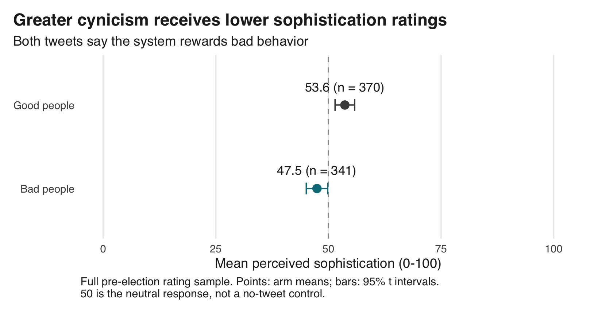

# Is Cynicism Taken as Evidence of Political Sophistication?

Gaurav Sood and Alexander G. Theodoridis

## TL;DR

In a two-arm comparison in the 2020 Cooperative Election Study UCM module,
711 respondents rated one of two tweets. Both said the system rewards bad
behavior; one said politics attracts **good people**, the other **bad people**.
The bad-people tweet scored lower: the difference was **-6.2 points on
a 0–100 sophistication scale (95% CI [-9.4, -3.0])**. Covariate adjustment and survey weighting preserve the
negative difference. In this comparison, greater cynicism carries a
sophistication penalty.

[Read the paper](ms/main.pdf) · [Citation](CITATION.cff)

## Research design

The comparison uses these two statements:

> Politics attracts good people but the system rewards bad behavior.
>
> Politics attracts bad people and the system rewards bad behavior.

Respondents rated perceived sophistication on a seven-point scale, rescaled to
0–100 with higher scores meaning more sophisticated. The primary estimate is the
unweighted difference in means, **bad people minus good people**, with a Welch
95% confidence interval.

The larger source file contains 1427 respondents. Survey routing gives
711 the tweet rating and 716 a separate question about their own
beliefs. Everyone answers their assigned question, but nobody has both outcomes;
we therefore cannot test whether personal cynicism moderates the rating effect.
The supplied weighted file is an overlapping 1000-person subset.

A causal interpretation requires random assignment within the rating sample.
Assignment fields support that reading, but the original questionnaire and
randomization program are unavailable. The study compares two complete statements
about who enters politics, both critical of the system; it measures perceived
sophistication, not actual political knowledge.

## Main findings

The bad-people tweet averages **47.5**, compared with **53.6** for the
good-people tweet. The share rating it at least somewhat sophisticated falls from
**37.8% to 24.9%**.



| Specification | Difference, bad minus good (95% CI) |
|---|---:|
| Primary: all respondents assigned the rating | -6.2 ([-9.4, -3.0]) |
| Covariate adjusted | -5.9 ([-9.2, -2.6]) |
| Matched subset, unweighted | -7.1 ([-10.9, -3.3]) |
| Matched subset, survey weighted | -7.9 ([-12.5, -3.3]) |

These estimates use overlapping samples and different targets; they are
sensitivity checks, not independent replications. See the
[comparison plot](figs/estimates.png) for all sample and scoring specifications.

The finding weighs against a sophistication premium for the more cynical
statement in this setting. It does not establish a general penalty for cynicism:
respondents could be reacting to pessimism about people, agreement with the
statement, or the distinction it draws between people and institutions. The
design cannot separate those explanations.

See the [data guide](data/README.md), [design and estimands](docs/design.md), and
[analysis checks](docs/checks.md) for coding, assumptions, and robustness checks.

## Repository

| Path | Contents |
|---|---|
| `data/cces/` | Original SPSS files and codebooks, unchanged |
| `data/derived/` | Locally generated respondent extract; ignored by Git |
| `treats/` | Original tweet images |
| `docs/treatments.csv` | Image text, assignment codes, and mapping uncertainty |
| `R/` | Data validation, estimates, inference, and figure style |
| `scripts/` | Analysis, figures, tables, and synchronized README/manuscript numbers |
| `tabs/` | Aggregate estimates, sample flow, diagnostics, and source hashes |
| `figs/` | Generated PDF and PNG figures |
| `ms/` | LaTeX report and compiled PDF |
| `tests/testthat/` | Coding, data reconciliation, independent numerical checks, and simulation |

## Reproduce

Requires R 4.6.0, XeLaTeX, and latexmk. From the repository root:

```sh
make restore
make check
```

`make check` rebuilds analysis, figures, tables, README, and PDF, then runs lint
and tests. GitHub Actions runs the same checks. `make format` applies styler.
Package versions are recorded in `renv.lock`.
The analysis uses only the supplied files and makes no live data downloads.

Every numerical result in the report comes from generated tables or
`tabs/macros.tex`. This README is generated from `docs/README.md.in`; edit that
template instead of copying updated estimates by hand.
